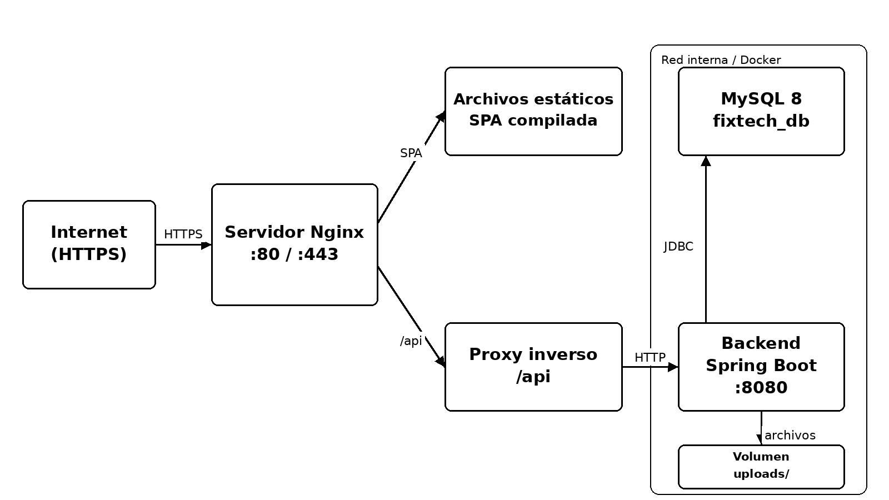

## 1. Introducción

Este manual describe el procedimiento para compilar, desplegar, verificar y mantener la aplicación FIXTECH en un servidor con Nginx o con Docker Compose. Está dirigido al responsable técnico del despliegue y supone conocimientos básicos de Linux, Nginx, Docker, Java y bases de datos MySQL.

FIXTECH se compone de dos artefactos independientes:

- Una SPA Angular 22 que se compila en archivos estáticos y se sirve con Nginx.
- Una API REST Spring Boot 4.1.1 que se ejecuta como proceso Java o como contenedor y persiste en MySQL 8.

En un despliegue típico, Nginx publica la SPA y actúa como proxy inverso de `/api` hacia el backend. De esta forma, el navegador consume la API bajo el mismo origen y se evita la exposición directa del puerto del backend.

## 2. Arquitectura de despliegue



La Figura 1 muestra los componentes del despliegue. El usuario accede por HTTPS al servidor Nginx. Nginx entrega los archivos estáticos de la SPA y redirige las peticiones `/api` al backend Spring Boot. El backend accede a MySQL y guarda los archivos en un volumen privado. En la variante Docker, los tres servicios se ejecutan en una red interna y solo el frontend publica un puerto al host.

| Componente        | Función                            | Exposición          |
| ----------------- | ---------------------------------- | ------------------- |
| Nginx             | Servidor de la SPA y proxy inverso | Público (80/443)    |
| Angular SPA       | Interfaz de usuario                | A través de Nginx   |
| Spring Boot       | API REST y reglas de negocio       | Interno (8080/8082) |
| MySQL 8           | Persistencia                       | Interno (3306)      |
| Volumen `uploads` | Fotos y comprobantes               | Interno             |
| Navegador         | Cliente de la aplicación           | Internet            |

## 3. Requisitos

### 3.1 Requisitos de hardware

| Recurso | Mínimo  | Recomendado |
| ------- | ------- | ----------- |
| CPU     | 2 vCPU  | 4 vCPU      |
| Memoria | 4 GB    | 8 GB        |
| Disco   | 40 GB   | 80 GB SSD   |
| Red     | 10 Mbps | 100 Mbps    |

### 3.2 Requisitos de software

| Software       | Versión mínima | Observación                     |
| -------------- | -------------- | ------------------------------- |
| Ubuntu Server  | 22.04 LTS      | 24.04 LTS recomendado           |
| Nginx          | 1.24           | Con módulo `http_ssl`           |
| Node.js        | 22.12          | Solo para compilar la SPA       |
| npm            | 10             | Gestión de dependencias         |
| Java           | 21             | Requerido por Spring Boot 4.1.1 |
| MySQL          | 8.0            | 8.4 recomendado                 |
| Docker         | 24             | Opcional                        |
| Docker Compose | 2.x            | Opcional; también se admite v1  |
| Certbot        | 2.x            | Para HTTPS con Let's Encrypt    |

### 3.3 Requisitos de red y DNS

- Un dominio o subdominio que resuelva a la IP del servidor.
- Puertos 80 y 443 abiertos en el cortafuegos.
- Acceso saliente para la actualización de paquetes y la emisión del certificado.
- El puerto del backend no debe exponerse a Internet.

### 3.4 Requisitos de base de datos

- Base de datos `fixtech_db` con codificación `utf8mb4` y colación `utf8mb4_general_ci`.
- Usuario de aplicación con permisos de lectura y escritura sobre `fixtech_db`.
- Esquema inicial importado desde `db/fixtech_db.sql` del repositorio backend.
- Copia de seguridad antes de importar el esquema, porque el script elimina y recrea las tablas.

## 4. Variables de entorno

El backend se configura con variables de entorno. La Tabla 4 presenta las variables principales.

| Variable                     | Obligatoria | Valor de ejemplo                         | Descripción                                            |
| ---------------------------- | ----------- | ---------------------------------------- | ------------------------------------------------------ |
| `SPRING_PROFILES_ACTIVE`     | Sí          | `prod`                                   | Perfil de ejecución; en producción deshabilita Swagger |
| `SERVER_PORT`                | No          | `8080`                                   | Puerto interno del backend                             |
| `FIXTECH_DB_URL`             | Sí          | `jdbc:mysql://mysql:3306/fixtech_db?...` | URL JDBC de MySQL                                      |
| `FIXTECH_DB_USER`            | Sí          | `fixtech`                                | Usuario de base de datos                               |
| `FIXTECH_DB_PASSWORD`        | Sí          | `••••••••`                               | Contraseña de base de datos                            |
| `FIXTECH_JWT_SECRET`         | Sí          | `openssl rand -hex 32`                   | Secreto HMAC para firmar JWT                           |
| `FIXTECH_CORS_ORIGINS`       | Sí          | `https://fixtech.example.com`            | Orígenes permitidos por CORS                           |
| `FIXTECH_ARCHIVOS_DIR`       | No          | `/app/uploads`                           | Directorio privado de archivos                         |
| `FIXTECH_OPENAPI_HABILITADO` | No          | `false`                                  | Habilita Swagger; debe ser `false` en producción       |
| `FIXTECH_CORREO_HABILITADO`  | No          | `false`                                  | Activa el envío de correos                             |
| `FIXTECH_CORREO_REMITENTE`   | No          | `no-reply@fixtech.pe`                    | Remitente de correos                                   |
| `SPRING_MAIL_HOST`           | No          | `smtp.example.com`                       | Servidor SMTP                                          |
| `SPRING_MAIL_PORT`           | No          | `587`                                    | Puerto SMTP                                            |
| `SPRING_MAIL_USERNAME`       | No          | `usuario`                                | Usuario SMTP                                           |
| `SPRING_MAIL_PASSWORD`       | No          | `••••••••`                               | Contraseña SMTP                                        |

Las variables del frontend se definen en tiempo de compilación mediante los archivos de entorno:

| Archivo                                | `apiUrl`                    | Uso        |
| -------------------------------------- | --------------------------- | ---------- |
| `src/environments/environment.ts`      | `http://localhost:8082/api` | Desarrollo |
| `src/environments/environment.prod.ts` | `/api`                      | Producción |

En producción no se debe cambiar `apiUrl` a una URL absoluta si Nginx publica la API bajo el mismo dominio. La ruta relativa `/api` aprovecha el proxy y evita problemas de CORS.

## 5. Compilación de la SPA

### 5.1 Preparación

```bash
cd /ruta/al/repositorio/fixtech-frontend
source ~/.nvm/nvm.sh
nvm use
npm ci
```

### 5.2 Build de producción

```bash
npm run build
```

El resultado se genera en:

```text
dist/fixtech-frontend/browser/
```

La compilación aplica el reemplazo de `environment.ts` por `environment.prod.ts`, la optimización de producción y los presupuestos definidos en `angular.json`. El resultado de referencia es de 604.53 kB iniciales y 146.40 kB de transferencia estimada.

### 5.3 Verificación del build

```bash
test -f dist/fixtech-frontend/browser/index.html && echo "Build OK"
grep -q '<app-root' dist/fixtech-frontend/browser/index.html && echo "SPA OK"
```

### 5.4 Cálculo del hash CSP

Angular inserta un script inline para activar el CSS crítico. La política CSP debe incluir su hash. Después de cada build:

```bash
python3 deploy/calcular-csp-hash.py dist/fixtech-frontend/browser/index.html
```

El comando devuelve una línea similar a:

```text
script-src 'self' 'sha256-LMY6wYoFV9I4wWzxaq1N/dTpl4iurQktw706UCHK3vM='
```

Si el hash cambia, actualice `deploy/nginx/fixtech.conf` y `deploy/nginx/fixtech.docker.conf.template` antes de desplegar. Un hash desactualizado bloquea el script inline y la hoja de estilos principal no se activa.

## 6. Despliegue con Nginx en un VPS

### 6.1 Instalación de Nginx

```bash
sudo apt update
sudo apt install -y nginx
sudo systemctl enable --now nginx
```

### 6.2 Publicación de los archivos estáticos

```bash
sudo mkdir -p /var/www/fixtech
sudo rsync -a --delete dist/fixtech-frontend/browser/ /var/www/fixtech/
sudo chown -R www-data:www-data /var/www/fixtech
sudo find /var/www/fixtech -type d -exec chmod 755 {} \;
sudo find /var/www/fixtech -type f -exec chmod 644 {} \;
```

### 6.3 Configuración de Nginx

Copie `deploy/nginx/fixtech.conf` al servidor y ajústelo:

```bash
sudo cp deploy/nginx/fixtech.conf /etc/nginx/sites-available/fixtech
sudo nano /etc/nginx/sites-available/fixtech
```

Cambie `server_name fixtech.example.com` por el dominio real. Verifique que `root` apunte a `/var/www/fixtech` y que `proxy_pass` apunte al backend correcto:

```nginx
server_name fixtech.example.com;
root /var/www/fixtech;
location /api/ {
    proxy_pass http://127.0.0.1:8082/api/;
}
```

Habilite el sitio y valide la configuración:

```bash
sudo ln -s /etc/nginx/sites-available/fixtech /etc/nginx/sites-enabled/fixtech
sudo nginx -t
sudo systemctl reload nginx
```

### 6.4 Backend como servicio systemd

El backend puede ejecutarse con el JAR de Spring Boot. Cree un usuario de servicio y un archivo de unidad:

```bash
sudo useradd --system --home /opt/fixtech --shell /usr/sbin/nologin fixtech
sudo mkdir -p /opt/fixtech/uploads
sudo chown -R fixtech:fixtech /opt/fixtech
```

Ejemplo de `/etc/systemd/system/fixtech-api.service`:

```ini
[Unit]
Description=FIXTECH API
After=network.target mysql.service

[Service]
User=fixtech
WorkingDirectory=/opt/fixtech
EnvironmentFile=/etc/fixtech/fixtech.env
ExecStart=/usr/bin/java -jar /opt/fixtech/fixtech-api.jar
Restart=on-failure
RestartSec=5
SuccessExitStatus=143

[Install]
WantedBy=multi-user.target
```

El archivo `/etc/fixtech/fixtech.env` debe contener las variables de la Tabla 4, con permisos `600`:

```bash
sudo install -m 600 /dev/null /etc/fixtech/fixtech.env
sudo nano /etc/fixtech/fixtech.env
```

Active el servicio:

```bash
sudo systemctl daemon-reload
sudo systemctl enable --now fixtech-api
sudo systemctl status fixtech-api
```

### 6.5 HTTPS con Let's Encrypt

```bash
sudo apt install -y certbot python3-certbot-nginx
sudo certbot --nginx -d fixtech.example.com
sudo systemctl status certbot.timer
```

Certbot modifica la configuración de Nginx para redirigir HTTP a HTTPS. Verifique que el proxy `/api` siga funcionando después de la emisión del certificado. Renueve el certificado con:

```bash
sudo certbot renew --dry-run
```

### 6.6 Verificación del despliegue

```bash
curl -I https://fixtech.example.com/
curl -I https://fixtech.example.com/login
curl -I https://fixtech.example.com/api/catalogos/distritos
```

Las tres respuestas deben ser 200. Si la API devuelve 502, revise el backend y la directiva `proxy_pass`. Si devuelve 403 con “Invalid CORS request”, revise `FIXTECH_CORS_ORIGINS`.

## 7. Despliegue con Docker Compose

### 7.1 Estructura

La carpeta `deploy/` contiene:

| Archivo                              | Función                               |
| ------------------------------------ | ------------------------------------- |
| `Dockerfile`                         | Imagen multietapa Node 22 + Nginx     |
| `docker-compose.yml`                 | Pila frontend, backend y MySQL        |
| `.env.example`                       | Plantilla de variables                |
| `nginx/fixtech.docker.conf.template` | Configuración de Nginx con `envsubst` |
| `smoke-test.sh`                      | Prueba de humo                        |
| `calcular-csp-hash.py`               | Cálculo del hash CSP                  |

### 7.2 Preparación del entorno

```bash
cd /ruta/al/repositorio/fixtech-frontend
cp deploy/.env.example deploy/.env
nano deploy/.env
```

Reemplace todos los valores marcados como “CAMBIE”. Genere el secreto JWT con:

```bash
openssl rand -hex 32
```

Ajuste `BACKEND_CONTEXT` si el repositorio backend no está en la ruta esperada. Ajuste `FIXTECH_CORS_ORIGINS` con el origen público real. Para el ejemplo local:

```text
FIXTECH_CORS_ORIGINS=http://localhost:8088,http://127.0.0.1:8088
```

### 7.3 Validación de la configuración

```bash
docker-compose -f deploy/docker-compose.yml --env-file deploy/.env config
```

La validación debe finalizar sin errores y mostrar los tres servicios. En Docker Compose v2:

```bash
docker compose -f deploy/docker-compose.yml --env-file deploy/.env config
```

### 7.4 Construcción y arranque

```bash
docker-compose -f deploy/docker-compose.yml --env-file deploy/.env up --build -d
```

El frontend queda disponible en `http://localhost:8088` por defecto. MySQL y el backend no se publican al host. Los volúmenes `mysql_data` y `uploads_data` conservan la base de datos y los archivos.

### 7.5 Verificación

```bash
docker-compose -f deploy/docker-compose.yml ps
curl -I http://localhost:8088/
curl -I http://localhost:8088/api/catalogos/distritos
```

### 7.6 Detención y actualización

```bash
docker-compose -f deploy/docker-compose.yml down
docker-compose -f deploy/docker-compose.yml up --build -d
```

`down` sin `-v` conserva los volúmenes. No use `down -v` salvo que desee eliminar la base de datos y los archivos.

### 7.7 Nota sobre el entorno de desarrollo

En el entorno de desarrollo del proyecto, la configuración de Docker Compose se validó con `docker-compose config`, pero la imagen no se construyó porque el daemon de Docker no era accesible sin permisos. La configuración queda preparada para ejecutarse en un host con Docker operativo. Esta observación no afecta el despliegue con Nginx, que sí fue verificado de extremo a extremo.

## 8. Configuración de CORS y `/api`

### 8.1 Mismo origen

La SPA de producción usa `apiUrl: '/api'`. El navegador resuelve la petición contra el mismo esquema, dominio y puerto de la SPA. Nginx recibe `/api/...` y la redirige al backend. Este diseño evita que el navegador tenga que autorizar un origen distinto y simplifica la configuración.

### 8.2 Origen permitido en el backend

Aunque la SPA y la API compartan dominio, el navegador envía el encabezado `Origin` en las peticiones que modifican datos. El backend valida ese origen contra `FIXTECH_CORS_ORIGINS`. Por lo tanto, el dominio público debe estar incluido:

```text
FIXTECH_CORS_ORIGINS=https://fixtech.example.com
```

Si se accede por `www`, incluya también ese origen:

```text
FIXTECH_CORS_ORIGINS=https://fixtech.example.com,https://www.fixtech.example.com
```

No use `*` en producción. Si la API se publica en un subdominio distinto, agregue ese origen y ajuste `apiUrl` en el build.

### 8.3 Proxy de Nginx

La directiva del proyecto es:

```nginx
location /api/ {
    proxy_pass http://127.0.0.1:8082/api/;
    proxy_http_version 1.1;
    proxy_set_header Host $host;
    proxy_set_header X-Real-IP $remote_addr;
    proxy_set_header X-Forwarded-For $proxy_add_x_forwarded_for;
    proxy_set_header X-Forwarded-Proto $scheme;
    proxy_connect_timeout 10s;
    proxy_read_timeout 60s;
    proxy_send_timeout 60s;
    client_max_body_size 30m;
}
```

`client_max_body_size 30m` permite la carga de fotografías. Si el backend limita el tamaño de archivo, mantenga ambos límites coherentes.

### 8.4 Diagnóstico de CORS

| Síntoma                    | Causa probable                                      | Solución                                          |
| -------------------------- | --------------------------------------------------- | ------------------------------------------------- |
| 403 “Invalid CORS request” | Origen no incluido                                  | Agregar el origen exacto a `FIXTECH_CORS_ORIGINS` |
| 403 solo en POST/PUT/PATCH | El navegador envía `Origin` y el backend lo rechaza | Incluir esquema, dominio y puerto exactos         |
| 502 Bad Gateway            | Backend detenido o upstream incorrecto              | Revisar `systemctl status` y `proxy_pass`         |
| 404 en `/api/...`          | `proxy_pass` sin `/api/` o ruta mal escrita         | Verificar la barra final y la ruta                |
| Preflight fallido          | Método o cabecera no permitidos                     | Revisar la configuración CORS del backend         |

## 9. Cabeceras de seguridad y CSP

Nginx aplica las cabeceras de la Tabla 12 en todas las respuestas.

| Cabecera                    | Valor                                      | Finalidad                                                     |
| --------------------------- | ------------------------------------------ | ------------------------------------------------------------- |
| `X-Content-Type-Options`    | `nosniff`                                  | Evita la interpretación incorrecta de tipos MIME              |
| `X-Frame-Options`           | `DENY`                                     | Impide el uso de la SPA en iframes                            |
| `Referrer-Policy`           | `strict-origin-when-cross-origin`          | Limita la información del referente                           |
| `Permissions-Policy`        | `camera=(), microphone=(), geolocation=()` | Restringe permisos del navegador                              |
| `Content-Security-Policy`   | Ver configuración                          | Restringe orígenes de scripts, estilos, imágenes y conexiones |
| `Strict-Transport-Security` | Recomendado en HTTPS                       | Fuerza HTTPS en visitas posteriores                           |

La CSP del proyecto es:

```text
default-src 'self';
script-src 'self' 'sha256-LMY6wYoFV9I4wWzxaq1N/dTpl4iurQktw706UCHK3vM=';
style-src 'self' 'unsafe-inline';
img-src 'self' data: blob:;
font-src 'self';
connect-src 'self';
object-src 'none';
base-uri 'self';
frame-ancestors 'none';
form-action 'self'
```

`style-src 'unsafe-inline'` es necesario por los estilos inline que genera Angular Material. `script-src` no usa `unsafe-inline`; el hash permite únicamente el script de activación del CSS crítico.

Para HTTPS, agregue HSTS después de confirmar que el certificado y la redirección funcionan:

```nginx
add_header Strict-Transport-Security "max-age=31536000; includeSubDomains" always;
```

## 10. Base de datos

### 10.1 Importación del esquema

El esquema se encuentra en `db/fixtech_db.sql` del repositorio backend. El script elimina y recrea las tablas, por lo que no debe ejecutarse sobre una base con datos que se quieran conservar.

```bash
mysql -u root -p < db/fixtech_db.sql
```

Para un usuario de aplicación:

```sql
CREATE USER 'fixtech'@'%' IDENTIFIED BY 'una_clave_segura';
GRANT SELECT, INSERT, UPDATE, DELETE ON fixtech_db.* TO 'fixtech'@'%';
FLUSH PRIVILEGES;
```

### 10.2 Copias de seguridad

El backend incluye `scripts/backup.sh` y `scripts/restore.sh`. Ejemplo de respaldo:

```bash
FIXTECH_DB_USER=root \
FIXTECH_DB_PASSWORD='su_clave' \
./scripts/backup.sh
```

Ejemplo de restauración:

```bash
FIXTECH_DB_USER=root \
FIXTECH_DB_PASSWORD='su_clave' \
./scripts/restore.sh backups/fixtech_db_20261025_180000.sql.gz
```

Programe una tarea diaria y pruebe la restauración periódicamente. Guarde las copias fuera del servidor de aplicación.

### 10.3 Archivos adjuntos

Las fotos de solicitudes, avances, constancias, reclamos y comprobantes se guardan en el directorio definido por `FIXTECH_ARCHIVOS_DIR`. En Docker se monta el volumen `uploads_data`. En un VPS, use `/opt/fixtech/uploads` o una ruta equivalente con permisos del usuario del servicio. Incluya este directorio en las copias de seguridad.

## 11. Prueba de humo

La prueba de humo verifica la SPA, el fallback, las fuentes, el proxy `/api`, las cabeceras y el login. Se ejecuta con:

```bash
SMOKE_ADMIN_EMAIL=admin@fixtech.pe \
SMOKE_ADMIN_PASSWORD='Admin123!' \
./deploy/smoke-test.sh https://fixtech.example.com
```

El script requiere `curl` y `python3`. No imprime tokens ni contraseñas. El resultado esperado es:

```text
========================================
Prueba de humo: OK
```

Si alguna comprobación falla, el script devuelve un código de salida distinto de cero y muestra el detalle. Use el código de salida en el pipeline de despliegue para detener una publicación defectuosa.

## 12. Operación y mantenimiento

### 12.1 Actualización de la SPA

```bash
git pull
npm ci
npm run build
python3 deploy/calcular-csp-hash.py dist/fixtech-frontend/browser/index.html
sudo rsync -a --delete dist/fixtech-frontend/browser/ /var/www/fixtech/
sudo nginx -t && sudo systemctl reload nginx
```

Si el hash CSP cambió, actualice la configuración de Nginx antes de recargar.

### 12.2 Actualización del backend

```bash
git pull
./mvnw clean package
sudo systemctl stop fixtech-api
sudo cp target/fixtech-api.jar /opt/fixtech/fixtech-api.jar
sudo systemctl start fixtech-api
```

Ajuste el nombre del JAR al artefacto real del proyecto. Verifique con `systemctl status` y con la prueba de humo.

### 12.3 Logs

| Componente      | Ubicación                         |
| --------------- | --------------------------------- |
| Nginx acceso    | `/var/log/nginx/access.log`       |
| Nginx errores   | `/var/log/nginx/error.log`        |
| Backend systemd | `journalctl -u fixtech-api -f`    |
| Docker          | `docker-compose logs -f`          |
| MySQL           | Log del contenedor o del servicio |

### 12.4 Monitoreo recomendado

- Disponibilidad de la SPA y de `/api/catalogos/distritos` cada minuto.
- Uso de CPU, memoria y disco.
- Latencia y tasa de errores del backend.
- Espacio libre en el volumen de archivos.
- Vigencia del certificado TLS.
- Crecimiento de la base de datos y de los archivos adjuntos.

## 13. Solución de problemas

| Problema                                           | Causa probable                                | Solución                                               |
| -------------------------------------------------- | --------------------------------------------- | ------------------------------------------------------ |
| Página en blanco                                   | Hash CSP desactualizado o error de JavaScript | Recalcular el hash y revisar la consola                |
| 404 al recargar una ruta                           | Falta el fallback a `index.html`              | Verificar `try_files $uri $uri/ /index.html`           |
| 502 en `/api`                                      | Backend detenido                              | Revisar el servicio y `proxy_pass`                     |
| 403 CORS                                           | Origen no permitido                           | Agregar el origen exacto a `FIXTECH_CORS_ORIGINS`      |
| 413 al subir fotos                                 | Límite de Nginx o del backend                 | Ajustar `client_max_body_size` y el límite del backend |
| Fuentes no cargan                                  | Ruta o permisos incorrectos                   | Verificar `/fonts/` y los permisos de archivos         |
| Login funciona en desarrollo pero no en producción | `apiUrl` absoluto o CORS                      | Usar `/api` y configurar el origen                     |
| Cambios no visibles                                | Caché de `index.html`                         | Verificar `expires -1` y recargar sin caché            |
| Error de conexión a MySQL                          | URL, usuario o contraseña                     | Revisar variables y conectividad                       |
| Certificado vencido                                | Renovación automática detenida                | Ejecutar `certbot renew` y revisar el timer            |

## 14. Checklist de despliegue

| N.º | Actividad                                      | Cumple |
| --: | ---------------------------------------------- | ------ |
|   1 | Build de producción generado sin errores       | ☐      |
|   2 | Hash CSP recalculado y actualizado             | ☐      |
|   3 | Archivos copiados a `/var/www/fixtech`         | ☐      |
|   4 | Configuración de Nginx ajustada al dominio     | ☐      |
|   5 | `nginx -t` sin errores                         | ☐      |
|   6 | Backend en ejecución y accesible               | ☐      |
|   7 | `FIXTECH_CORS_ORIGINS` con el origen público   | ☐      |
|   8 | Base de datos importada y usuario creado       | ☐      |
|   9 | Directorio de archivos con permisos correctos  | ☐      |
|  10 | HTTPS configurado y renovación activa          | ☐      |
|  11 | Prueba de humo con 14 comprobaciones correctas | ☐      |
|  12 | Login y perfil verificados en el navegador     | ☐      |
|  13 | Copia de seguridad inicial realizada           | ☐      |
|  14 | Monitoreo y alertas configurados               | ☐      |
|  15 | Procedimiento de reversión documentado         | ☐      |

## 15. Anexos

### 15.1 Archivos de referencia

| Archivo                                     | Contenido                        |
| ------------------------------------------- | -------------------------------- |
| `deploy/nginx/fixtech.conf`                 | Configuración de Nginx para VPS  |
| `deploy/nginx/fixtech.docker.conf.template` | Configuración para el contenedor |
| `deploy/Dockerfile`                         | Imagen multietapa                |
| `deploy/docker-compose.yml`                 | Pila completa                    |
| `deploy/.env.example`                       | Variables de ejemplo             |
| `deploy/smoke-test.sh`                      | Prueba de humo                   |
| `deploy/calcular-csp-hash.py`               | Cálculo del hash CSP             |
| `e2e/seed/seed-e2e.mjs`                     | Datos semilla de pruebas         |

### 15.2 Comandos rápidos

```bash
# Build y publicación
npm ci && npm run build
sudo rsync -a --delete dist/fixtech-frontend/browser/ /var/www/fixtech/
sudo nginx -t && sudo systemctl reload nginx

# Hash CSP
python3 deploy/calcular-csp-hash.py dist/fixtech-frontend/browser/index.html

# Prueba de humo
SMOKE_ADMIN_EMAIL=admin@fixtech.pe \
SMOKE_ADMIN_PASSWORD='Admin123!' \
./deploy/smoke-test.sh https://fixtech.example.com

# Docker
cp deploy/.env.example deploy/.env
docker-compose -f deploy/docker-compose.yml --env-file deploy/.env up --build -d
```
