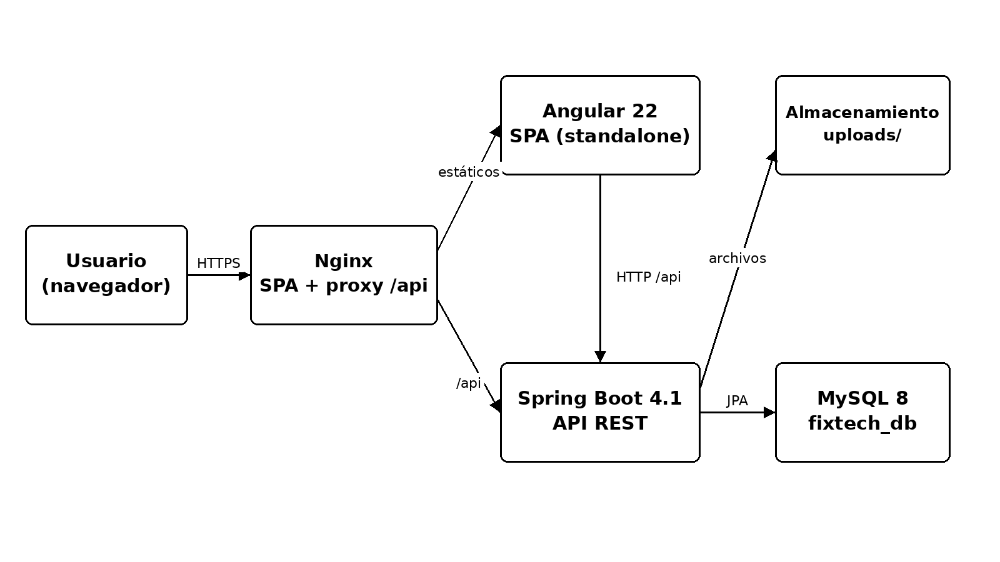
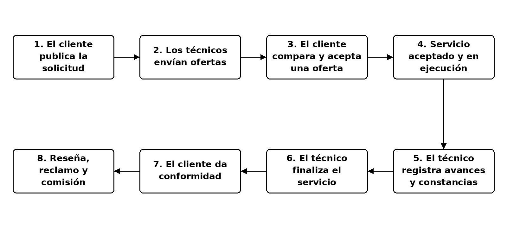

## 1. Introducción

Este documento describe la arquitectura, los módulos, los flujos y las decisiones técnicas de FIXTECH. Está dirigido al equipo de desarrollo, a los responsables de mantenimiento y a los evaluadores técnicos del proyecto. La documentación se basa en el código del repositorio frontend, en la API OpenAPI del backend y en la evidencia de las pruebas de cierre.

FIXTECH es una plataforma web para la gestión de solicitudes de soporte y mantenimiento tecnológico en Piura. Conecta a clientes que necesitan atención con técnicos verificados que ofrecen sus servicios. La plataforma cubre el ciclo completo: publicación de la solicitud, recepción de ofertas, negociación, aceptación, ejecución, constancias, conformidad, reseña, reclamo, comisión y pago.

## 2. Visión del producto

| Elemento     | Descripción                                                            |
| ------------ | ---------------------------------------------------------------------- |
| Nombre       | FIXTECH                                                                |
| Propósito    | Conectar clientes con técnicos verificados para servicios tecnológicos |
| Ciudad       | Piura, Perú                                                            |
| Roles        | Cliente, técnico y administrador                                       |
| Modelo       | Publicación de solicitudes y recepción de ofertas                      |
| Canal        | Aplicación web responsive                                              |
| Idioma       | Español (Perú)                                                         |
| Moneda       | Sol peruano (PEN)                                                      |
| Zona horaria | America/Lima                                                           |

### 2.1 Problema que resuelve

Los clientes que necesitan reparar o mantener un equipo tecnológico suelen buscar técnicos por recomendación, redes sociales o avisos informales. Esto dificulta comparar precios, verificar la identidad del técnico, dar seguimiento al servicio y dejar constancia de lo ocurrido. FIXTECH centraliza la solicitud, la oferta, la ejecución y el cierre en un solo flujo, con reglas de verificación, comisiones, reseñas y reclamos.

### 2.2 Propuesta de valor

- El cliente publica una solicitud con fotos, distrito, equipo y descripción.
- Los técnicos aprobados envían ofertas o contraofertas.
- El cliente compara y acepta una oferta.
- El servicio se ejecuta con estados, mensajes, avances y constancias.
- El cierre habilita la conformidad, la reseña y el reclamo.
- El administrador verifica técnicos, modera reseñas, atiende reclamos, valida pagos y consulta reportes.

## 3. Arquitectura de la solución



La solución sigue una arquitectura cliente-servidor en tres capas:

1. **Presentación:** SPA Angular 22 que se ejecuta en el navegador. Gestiona rutas, formularios, estado de sesión, accesibilidad y experiencia de usuario.
2. **Lógica de negocio:** API REST Spring Boot 4.1.1. Valida reglas, autoriza por rol y propiedad, gestiona transacciones y expone DTOs.
3. **Persistencia:** MySQL 8 para datos relacionales y un directorio privado para archivos.

Nginx cumple dos funciones: sirve los archivos estáticos de la SPA y actúa como proxy inverso de `/api` hacia el backend. En desarrollo, la SPA se ejecuta en el puerto 4200 y consume directamente `http://localhost:8082/api`.

| Capa          | Tecnología                                     | Responsabilidad                                  |
| ------------- | ---------------------------------------------- | ------------------------------------------------ |
| Presentación  | Angular 22, TypeScript, SCSS, Angular Material | Interfaz, rutas, formularios, estado             |
| Servidor web  | Nginx 1.24                                     | Estáticos, fallback SPA, proxy, caché, seguridad |
| Lógica        | Spring Boot 4.1.1, Java 21                     | API REST, reglas, autorización, transacciones    |
| Persistencia  | MySQL 8, Spring Data JPA                       | Datos relacionales                               |
| Archivos      | Sistema de archivos privado                    | Fotos y comprobantes                             |
| Autenticación | JWT, BCrypt                                    | Sesión y control de acceso                       |

### 3.1 Decisiones de arquitectura

| Decisión                      | Justificación                                                     | Consecuencia                                                     |
| ----------------------------- | ----------------------------------------------------------------- | ---------------------------------------------------------------- |
| SPA sin SSR                   | El producto es una aplicación autenticada; no requiere indexación | Menor complejidad operativa; el primer render depende del bundle |
| Angular standalone            | Menos módulos y mejor tree-shaking                                | Componentes más simples y carga diferida                         |
| Signals                       | Estado reactivo local y derivado                                  | Menos suscripciones manuales                                     |
| Lazy loading por ruta         | Reduce el bundle inicial                                          | Cargas adicionales al navegar                                    |
| JWT en `sessionStorage`       | Simplicidad para el MVP                                           | Limitación frente a XSS y sesión por pestaña                     |
| Nginx como proxy              | Mismo origen para SPA y API                                       | Menos CORS y menor exposición del backend                        |
| DTOs en el backend            | No exponer entidades                                              | Contratos estables                                               |
| OpenAPI como fuente de verdad | Evita inventar campos                                             | Brechas documentadas                                             |

## 4. Stack tecnológico

| Área               | Tecnología                      | Versión      |
| ------------------ | ------------------------------- | ------------ |
| Framework frontend | Angular                         | 22.2         |
| Lenguaje           | TypeScript                      | 5.9          |
| Estilos            | SCSS                            | —            |
| Componentes        | Angular Material                | 22.2.4       |
| Estado             | Signals, computed, linkedSignal | —            |
| Pruebas unitarias  | Vitest + jsdom                  | 4.x          |
| Pruebas E2E        | Playwright                      | 1.64.1       |
| Accesibilidad      | Axe Core para Playwright        | 4.14.0       |
| Lint               | ESLint + angular-eslint         | 10.12 / 22.6 |
| Formato            | Prettier                        | 3.8.1        |
| Backend            | Spring Boot                     | 4.1.1        |
| Lenguaje backend   | Java                            | 21           |
| Persistencia       | MySQL                           | 8.4          |
| Seguridad          | Spring Security, JWT, BCrypt    | —            |
| Documentación API  | springdoc-openapi               | 3.2.0        |
| Servidor web       | Nginx                           | 1.24         |
| Contenedores       | Docker, Docker Compose          | 29.1 / 1.29  |
| Carga              | Apache JMeter                   | 5.6.3        |
| Seguridad          | OWASP ZAP                       | 2.16.1       |

## 5. Estructura del repositorio frontend

```text
fixtech-frontend/
├── src/
│   ├── app/
│   │   ├── core/
│   │   │   ├── auth/            # sesión, guards, interceptores, refresh
│   │   │   ├── catalogos/       # catálogos públicos
│   │   │   ├── conexion/        # aviso de conexión
│   │   │   ├── http/            # errores, descargas, URLs de archivos
│   │   │   ├── layout/          # layouts público y privado
│   │   │   ├── models/          # etiquetas y fechas
│   │   │   └── notificaciones/  # servicio de notificaciones
│   │   ├── features/
│   │   │   ├── admin/           # técnicos, usuarios, reseñas, reclamos,
│   │   │   │                    # comisiones, catálogos, parámetros,
│   │   │   │                    # reportes y auditoría
│   │   │   ├── auth/            # login y registros
│   │   │   ├── cliente/         # solicitudes del cliente
│   │   │   ├── comisiones/      # pagos y comprobantes
│   │   │   ├── dashboard/       # panel inicial por rol
│   │   │   ├── errors/          # 403 y 404
│   │   │   ├── notificaciones/  # bandeja
│   │   │   ├── ofertas/         # comparación y negociación
│   │   │   ├── perfil/          # cuenta de solo lectura
│   │   │   ├── servicios/       # ejecución, avances, constancias,
│   │   │   │                    # mensajes, reseñas y reclamos
│   │   │   └── tecnico/         # perfil, solicitudes y ofertas
│   │   └── shared/ui/           # componentes reutilizables
│   ├── environments/            # desarrollo y producción
│   ├── public/fonts/            # Roboto y Material Symbols
│   └── styles.scss              # estilos globales y tokens
├── e2e/                         # Playwright, baselines y seed
├── deploy/                      # Nginx, Docker, smoke test y CSP
├── docs/word/                   # documentos y diagramas
├── scripts/                     # generación de diagramas y documentos
└── angular.json                 # build, presupuestos y estilos
```

### 5.1 Convenciones

- Componentes standalone, sin `NgModule`.
- `input()`, `output()` y `model()` en lugar de decoradores de propiedades.
- `inject()` en lugar de inyección por constructor.
- Control de flujo nativo `@if`, `@for` y `@switch`.
- `class` y `style` bindings en lugar de `ngClass` y `ngStyle`.
- Servicios con `providedIn: 'root'` o `@Service` cuando aplica.
- Rutas con `loadComponent` para carga diferida.
- Nombres de archivos en kebab-case y sufijos `.page.ts`, `.service.ts`, `.spec.ts`.

## 6. Módulos y rutas

La Tabla 7 presenta las rutas principales de la SPA y el rol que puede acceder.

| Ruta                                            | Módulo                          | Rol              |
| ----------------------------------------------- | ------------------------------- | ---------------- |
| `/login`                                        | Inicio de sesión                | Público          |
| `/registro`                                     | Registro de cliente             | Público          |
| `/registro-tecnico`                             | Registro de técnico             | Público          |
| `/app/inicio`                                   | Panel inicial                   | Todos            |
| `/app/notificaciones`                           | Bandeja de notificaciones       | Todos            |
| `/app/perfil`                                   | Mi cuenta                       | Todos            |
| `/app/cliente/solicitudes`                      | Mis solicitudes                 | Cliente          |
| `/app/cliente/solicitudes/nueva`                | Nueva solicitud                 | Cliente          |
| `/app/cliente/solicitudes/:id`                  | Detalle de solicitud            | Cliente          |
| `/app/cliente/solicitudes/:id/editar`           | Edición de solicitud            | Cliente          |
| `/app/cliente/servicios`                        | Mis servicios                   | Cliente          |
| `/app/cliente/servicios/:id`                    | Detalle del servicio            | Cliente          |
| `/app/tecnico/perfil`                           | Perfil profesional              | Técnico          |
| `/app/tecnico/solicitudes`                      | Solicitudes disponibles         | Técnico aprobado |
| `/app/tecnico/solicitudes/:id`                  | Detalle de solicitud disponible | Técnico aprobado |
| `/app/tecnico/solicitudes/:solicitudId/ofertar` | Enviar oferta                   | Técnico aprobado |
| `/app/tecnico/ofertas`                          | Mis ofertas                     | Técnico aprobado |
| `/app/tecnico/ofertas/:ofertaId/editar`         | Editar oferta                   | Técnico aprobado |
| `/app/tecnico/servicios`                        | Mis servicios                   | Técnico          |
| `/app/tecnico/servicios/:id`                    | Detalle del servicio            | Técnico          |
| `/app/tecnico/comisiones`                       | Comisiones y pagos              | Técnico          |
| `/app/admin/tecnicos`                           | Verificación de técnicos        | Administrador    |
| `/app/admin/usuarios`                           | Usuarios y accesos              | Administrador    |
| `/app/admin/resenas`                            | Moderación de reseñas           | Administrador    |
| `/app/admin/reclamos`                           | Seguimiento de reclamos         | Administrador    |
| `/app/admin/comisiones`                         | Pagos y deudores                | Administrador    |
| `/app/admin/catalogos`                          | Catálogos                       | Administrador    |
| `/app/admin/parametros`                         | Parámetros del sistema          | Administrador    |
| `/app/admin/reportes`                           | Reportes e indicadores          | Administrador    |
| `/app/admin/auditoria`                          | Auditoría                       | Administrador    |
| `/no-autorizado`                                | Acceso denegado                 | Público          |
| `/**`                                           | Página no encontrada            | Público          |

### 6.1 Layout público

El layout público se usa para login, registro de cliente y registro de técnico. Incluye la marca FIXTECH, un contenedor centrado, navegación limitada y pie de página. El `guestGuard` redirige a `/app/inicio` si el usuario ya tiene sesión.

### 6.2 Layout privado

El layout privado incluye una barra superior, un sidenav responsive, el menú de usuario y la navegación por rol. En móvil, el sidenav se abre como panel superpuesto. La barra superior muestra el nombre del usuario, el rol y el acceso al menú de cuenta. El pie del sidenav muestra la versión y el estado de la conexión.

### 6.3 Panel inicial

El panel muestra un saludo personalizado, el estado de la cuenta y accesos rápidos a los módulos del rol. Para el técnico, muestra el estado de verificación, la deuda, el saldo y las modalidades de atención. Para el administrador, muestra indicadores generales y accesos a los módulos administrativos.

## 7. Autenticación y sesión

### 7.1 Flujo de inicio de sesión

1. El usuario ingresa correo y contraseña en `/login`.
2. La SPA envía `POST /api/auth/login`.
3. El backend valida las credenciales y devuelve `accessToken`, `refreshToken`, expiración y perfil.
4. `SessionStore` guarda la sesión en `sessionStorage`.
5. `AuthService` actualiza el estado reactivo del usuario.
6. El `guestGuard` redirige a `/app/inicio`.
7. El interceptor agrega `Authorization: Bearer <token>` a las peticiones autenticadas.

### 7.2 Renovación del token

`token-refresh.service.ts` coordina la renovación. Ante un 401, el interceptor evita duplicar la renovación, llama a `POST /api/auth/refresh` y reintenta la petición original una sola vez. Si la renovación falla, limpia la sesión, muestra el aviso de sesión expirada y redirige al login.

### 7.3 Guards

| Guard                  | Función                                                      |
| ---------------------- | ------------------------------------------------------------ |
| `authGuard`            | Exige sesión activa; conserva `returnUrl` interno            |
| `guestGuard`           | Impide que un usuario autenticado vuelva al login o registro |
| `roleGuard`            | Valida que el rol del usuario esté en `data.roles`           |
| `tecnicoAprobadoGuard` | Exige técnico aprobado y sin bloqueo por deuda para ofertar  |

El `returnUrl` solo acepta rutas internas bajo `/app`. Las URLs absolutas o externas se descartan para evitar redirecciones abiertas.

### 7.4 Cierre de sesión

El cierre manual limpia `SessionStore`, el estado de autenticación y el `returnUrl`. El cierre por expiración se activa cuando el token vence o la renovación falla. La interfaz muestra un aviso accesible y redirige al login.

### 7.5 Limitación de `sessionStorage`

La sesión se guarda en `sessionStorage` por decisión del MVP. Esto implica:

- La sesión no se comparte entre pestañas.
- La sesión se pierde al cerrar la pestaña.
- Los tokens son legibles por JavaScript y, por tanto, vulnerables ante XSS.

La alternativa recomendada para producción es usar cookies `HttpOnly`, `Secure` y `SameSite` con protección CSRF y mantener el token de acceso en memoria. La migración requiere cambios en el backend y en el interceptor.

## 8. Roles y permisos

| Funcionalidad                | Cliente | Técnico      | Administrador |
| ---------------------------- | ------- | ------------ | ------------- |
| Iniciar sesión               | Sí      | Sí           | Sí            |
| Registrarse                  | Sí      | Sí           | No            |
| Ver panel inicial            | Sí      | Sí           | Sí            |
| Gestionar notificaciones     | Sí      | Sí           | Sí            |
| Ver mi cuenta                | Sí      | Sí           | Sí            |
| Crear solicitud              | Sí      | No           | No            |
| Editar o cancelar solicitud  | Sí      | No           | No            |
| Ver solicitudes disponibles  | No      | Sí, aprobado | No            |
| Enviar oferta o contraoferta | No      | Sí, aprobado | No            |
| Aceptar oferta               | Sí      | No           | No            |
| Ejecutar servicio            | No      | Sí           | No            |
| Registrar avances            | No      | Sí           | No            |
| Registrar constancias        | No      | Sí           | No            |
| Dar conformidad              | Sí      | No           | No            |
| Crear reseña                 | Sí      | No           | No            |
| Responder reseña             | No      | Sí           | No            |
| Crear reclamo                | Sí      | No           | No            |
| Responder reclamo            | No      | Sí           | No            |
| Moderar reseña               | No      | No           | Sí            |
| Gestionar reclamo            | No      | No           | Sí            |
| Ver comisiones               | No      | Sí           | Sí            |
| Registrar pago               | No      | Sí           | No            |
| Validar pago                 | No      | No           | Sí            |
| Gestionar catálogos          | No      | No           | Sí            |
| Gestionar parámetros         | No      | No           | Sí            |
| Ver reportes                 | No      | No           | Sí            |
| Ver auditoría                | No      | No           | Sí            |
| Verificar técnicos           | No      | No           | Sí            |
| Gestionar usuarios           | No      | No           | Sí            |

### 8.1 Restricciones del técnico

El técnico debe estar aprobado para acceder a solicitudes disponibles, ofertas y negociación. Si está bloqueado por deuda, la SPA oculta las rutas y muestra el estado en el panel. El backend también valida la aprobación y el bloqueo al crear una oferta; la interfaz no sustituye la validación del servidor.

## 9. Flujo principal del servicio



El flujo principal se compone de las siguientes etapas:

1. **Publicación:** el cliente crea una solicitud con equipo, tipo de servicio, distrito, descripción, dirección y fotos.
2. **Oferta:** los técnicos aprobados consultan las solicitudes disponibles y envían una oferta con precio, plazo y comentario.
3. **Negociación:** el cliente puede aceptar, rechazar o solicitar una contraoferta. El técnico puede responder con una nueva propuesta.
4. **Aceptación:** al aceptar una oferta, se crea el servicio y se rechazan las demás ofertas de la solicitud.
5. **Ejecución:** el técnico avanza por los estados del servicio, registra avances con fotos, usa el PIN de inicio y se comunica por mensajería.
6. **Ajuste de precio:** si el diagnóstico revela un cambio, el técnico propone un ajuste y el cliente responde.
7. **Constancias:** en la modalidad de taller, el técnico registra la recepción y la entrega con fotos; el cliente confirma.
8. **Finalización:** el técnico finaliza el servicio; el cliente da conformidad o se aplica la conformidad automática configurada.
9. **Cierre:** se habilitan la reseña, el reclamo y el cálculo de la comisión.
10. **Pago:** el técnico registra el pago de la comisión y el administrador lo valida.

### 9.1 Estados

| Entidad   | Estados principales                                                                                                                                                                                    |
| --------- | ------------------------------------------------------------------------------------------------------------------------------------------------------------------------------------------------------ |
| Solicitud | `PUBLICADA`, `CON_OFERTAS`, `ACEPTADA`, `VENCIDA`, `CANCELADA`                                                                                                                                         |
| Oferta    | `ENVIADA`, `CONTRAOFERTADA`, `ACEPTADA`, `RECHAZADA`, `RETIRADA`, `EXPIRADA`                                                                                                                           |
| Servicio  | `PROGRAMADO`, `TECNICO_EN_CAMINO`, `EQUIPO_RECIBIDO`, `EN_DIAGNOSTICO`, `PENDIENTE_AJUSTE`, `EN_PROCESO`, `EN_REPARACION`, `LISTO_PARA_RECOGER`, `FINALIZADO`, `CONFIRMADO`, `CALIFICADO`, `CANCELADO` |
| Reclamo   | `ABIERTO`, `EN_REVISION`, `RESUELTO`, `CERRADO`                                                                                                                                                        |

## 10. Consumo de la API

### 10.1 Convenciones

- La URL base de producción es `/api`.
- Las peticiones autenticadas usan `Authorization: Bearer <token>`.
- Los cuerpos se envían en JSON, excepto las cargas multipart de fotos y constancias.
- Las fechas se manejan en ISO 8601 y se formatean en `es-PE`.
- La moneda se formatea en soles peruanos.
- Los errores del backend se normalizan en `ApiError` con código, mensaje y detalles.
- Las descargas autenticadas se realizan como blob y se convierten en URL temporal.
- Las imágenes autenticadas se solicitan con el token y se muestran como blob.

### 10.2 Manejo de errores

`error.interceptor.ts` captura las respuestas de error y las normaliza. Los componentes muestran mensajes en línea o notificaciones según el contexto. El interceptor de autenticación tiene prioridad para el 401 y evita que el error se muestre dos veces. Las peticiones que el usuario cancela o que son secundarias pueden silenciarse con `silenciar-error.ts`.

### 10.3 Catálogos

Los catálogos públicos se consultan al iniciar los formularios: tipos de equipo, tipos de servicio, especialidades y distritos. Se cachean en memoria durante la sesión para evitar peticiones repetidas. El administrador gestiona los mismos catálogos con endpoints de creación, edición y cambio de estado.

### 10.4 Archivos

Las fotos de solicitudes, avances, constancias, reclamos y comprobantes se guardan en el backend y se sirven mediante endpoints autenticados. La SPA no expone URLs públicas de archivos privados. `imagen-autenticada.ts` descarga el archivo como blob y lo muestra con `object-fit: cover`.

### 10.5 Anexo de endpoints

La Tabla 11 lista las 98 operaciones documentadas en OpenAPI al cierre del frontend. La fuente de verdad es el backend; esta tabla es un resumen de consulta.

<!-- include: api-endpoints.md -->

## 11. Componentes y patrones

### 11.1 Componentes standalone

Todos los componentes son standalone. Las rutas usan `loadComponent` para cargar cada página bajo demanda. Los componentes compartidos se encuentran en `shared/ui` y se importan directamente en las plantillas que los usan.

### 11.2 Estado con signals

El estado local se gestiona con `signal`, `computed` y `linkedSignal`. Los servicios exponen signals de solo lectura cuando el estado es compartido. Las plantillas consumen los signals directamente, sin `async` pipe salvo para observables externos.

### 11.3 Formularios

Los formularios usan Reactive Forms con validadores síncronos y asíncronos. Los mensajes de error se muestran junto al campo y se anuncian a lectores de pantalla. Los formularios de solicitud, oferta, registro y perfil validan longitudes, formatos y campos obligatorios antes de enviar.

### 11.4 Tablas y paginación

Las tablas administrativas usan Angular Material con paginación local o del servidor según el endpoint. Los filtros se aplican con debounce para evitar peticiones excesivas. Las tablas incluyen encabezados accesibles, orden visual y estados vacíos.

### 11.5 Diálogos y confirmaciones

Las acciones destructivas o irreversibles usan `confirmar-accion-dialog.ts`. El diálogo indica la acción, el objeto afectado y las consecuencias. Las acciones exitosas muestran una notificación breve y actualizan el estado local.

### 11.6 Notificaciones

El servicio de notificaciones consulta la bandeja y el contador de no leídas. El badge del menú se actualiza cada 60 segundos. La bandeja permite filtrar por no leídas y marcar todas como leídas. No hay WebSocket ni SSE; la actualización es por polling y por acción del usuario.

## 12. Accesibilidad

| Criterio    | Implementación                                |
| ----------- | --------------------------------------------- |
| Idioma      | `lang="es"` en el documento                   |
| Títulos     | Un `h1` por página y jerarquía de encabezados |
| Formularios | Etiquetas asociadas, ayudas y errores         |
| Foco        | Foco visible y gestión al abrir diálogos      |
| Teclado     | Navegación completa sin ratón                 |
| Contraste   | Tokens con contraste AA                       |
| Movimiento  | Respeto de `prefers-reduced-motion`           |
| Imágenes    | Texto alternativo o decorativo                |
| Tablas      | Encabezados y resúmenes                       |
| Avisos      | Regiones `aria-live` para mensajes dinámicos  |

Axe se ejecuta en las pruebas E2E sobre las pantallas principales. El resultado de cierre es cero violaciones en las reglas evaluadas. La verificación manual con lectores de pantalla queda recomendada.

## 13. Rendimiento

- Bundle inicial de 604.53 kB y 146.40 kB de transferencia estimada.
- Carga diferida de rutas y componentes pesados.
- Fuentes autoalojadas con `preload`.
- Subconjunto de iconos con los 133 nombres usados.
- Imágenes autenticadas descargadas como blob y cacheadas por el navegador.
- `trackBy` implícito en `@for` mediante `track`.
- Evitación de cálculos costosos en plantillas.
- `ChangeDetectionStrategy` por defecto de Angular 22.
- Compresión gzip en Nginx.
- Caché de un año para archivos con hash y sin caché para `index.html`.

## 14. Seguridad

| Control       | Implementación                                               |
| ------------- | ------------------------------------------------------------ |
| Autenticación | JWT firmado con HMAC                                         |
| Contraseñas   | BCrypt en el backend                                         |
| Autorización  | Guards en la SPA y validación de rol/propiedad en el backend |
| Sesión        | `sessionStorage` con expiración y refresh                    |
| Redirecciones | `returnUrl` solo interno                                     |
| Cabeceras     | CSP, `X-Frame-Options`, `nosniff`, `Referrer-Policy`         |
| Archivos      | Descarga autenticada; validación de tipo y tamaño            |
| Secretos      | Variables de entorno; `.env` excluido de Git                 |
| Swagger       | Deshabilitado en producción                                  |
| Auditoría     | Registro de acciones críticas en el backend                  |
| CORS          | Origen público explícito                                     |

### 14.1 Política de contenido

La CSP restringe los scripts al mismo origen y al hash del script inline de Angular. Los estilos permiten `unsafe-inline` por Angular Material. Las imágenes permiten `data:` y `blob:` para las descargas autenticadas. Las conexiones se limitan al mismo origen. No se permite el uso de la SPA en iframes.

### 14.2 Riesgos residuales

- XSS con acceso a `sessionStorage`.
- Falta de recuperación y cambio de contraseña.
- Falta de prueba de penetración profunda.
- Dependencia de la configuración correcta de CORS en producción.
- Hash CSP que debe actualizarse con cada build.

## 15. Pruebas y calidad

| Tipo          | Herramienta       | Resultado                                |
| ------------- | ----------------- | ---------------------------------------- |
| Unitarias     | Vitest            | 501 pruebas; 0 fallos                    |
| E2E           | Playwright        | 54 ejecuciones; 51 aprobadas; 3 omitidas |
| Accesibilidad | Axe               | 0 violaciones                            |
| Lint          | ESLint            | Sin errores                              |
| Formato       | Prettier          | Sin diferencias                          |
| Build         | Angular CLI       | 604.53 kB iniciales                      |
| Humo          | `smoke-test.sh`   | 14 comprobaciones correctas              |
| Backend       | JUnit 5 + Mockito | 337 pruebas; 0 fallos                    |
| Cobertura     | JaCoCo            | 94.00 % servicios; 87.08 % global        |
| Carga         | JMeter            | p95 103 ms; 0 errores                    |
| Seguridad     | OWASP ZAP         | 0 altas, 0 medias, 0 bajas               |

### 15.1 Datos semilla

El script `e2e/seed/seed-e2e.mjs` crea o reutiliza tres cuentas de prueba:

| Rol           | Correo                   | Contraseña    |
| ------------- | ------------------------ | ------------- |
| Administrador | `admin@fixtech.pe`       | `Admin123!`   |
| Cliente       | `cliente.e2e@fixtech.pe` | `Cliente123!` |
| Técnico       | `tecnico.e2e@fixtech.pe` | `Tecnico123!` |

El técnico queda aprobado y con especialidad y distrito activos. El script es idempotente y no sobrescribe cuentas con otra contraseña. Solo debe usarse en desarrollo o en una base de pruebas.

## 16. Configuración de entornos

| Entorno    | Archivo               | `apiUrl`                    | Uso                |
| ---------- | --------------------- | --------------------------- | ------------------ |
| Desarrollo | `environment.ts`      | `http://localhost:8082/api` | `npm start`        |
| Producción | `environment.prod.ts` | `/api`                      | Build y despliegue |

El build de producción reemplaza el archivo mediante `fileReplacements` en `angular.json`. No se deben incluir credenciales en los archivos de entorno del frontend.

## 17. Brechas y limitaciones

Las brechas de API se documentan en `BRECHAS_PENDIENTES.md`. Las más relevantes para el mantenimiento son:

- Documentos de verificación del técnico sin controlador.
- Cambio y recuperación de contraseña sin endpoints.
- Búsqueda y perfil público de técnicos sin endpoint.
- Fotos no reemplazables al editar una solicitud.
- Edición del perfil general sin endpoint.
- Datos E2E sin limpieza automática.
- `OfertaResponse` sin resumen de la solicitud.
- Detalle de solicitud disponible solo mientras está vigente.
- Mensajería sin tiempo real.
- Pagos sin anulación ni desbloqueo manual.
- Catálogos sin borrado físico.

Estas limitaciones no se simulan en la interfaz. Cuando una funcionalidad no existe, la SPA la omite o muestra una explicación.

## 18. Mantenimiento y extensión

### 18.1 Agregar una ruta

1. Crear la página en `features/<módulo>/<página>`.
2. Declarar el componente standalone.
3. Agregar la ruta en `app.routes.ts` con `loadComponent`.
4. Aplicar `authGuard` y `roleGuard` según el rol.
5. Agregar el ítem de navegación en `app-layout.ts`.
6. Agregar pruebas unitarias y E2E.
7. Verificar accesibilidad y responsive.

### 18.2 Agregar un endpoint

1. Verificar el contrato en OpenAPI.
2. Crear o extender el modelo en `core` o en el módulo.
3. Implementar el método en el servicio con `HttpClient`.
4. Manejar errores con `ApiError`.
5. Agregar pruebas unitarias del servicio.
6. Agregar la interacción en la página.
7. Actualizar la documentación y las brechas si corresponde.

### 18.3 Actualizar Angular

1. Revisar la guía oficial de actualización.
2. Actualizar `@angular/*` y `@angular/material` en conjunto.
3. Ejecutar `npm install`.
4. Revisar cambios de API y de plantillas.
5. Ejecutar lint, pruebas, build y E2E.
6. Revisar el tamaño del bundle y los presupuestos.

## 19. Glosario

| Término      | Definición                                          |
| ------------ | --------------------------------------------------- |
| SPA          | Aplicación de una sola página                       |
| JWT          | Token web JSON firmado                              |
| Guard        | Función que autoriza o bloquea una ruta             |
| Interceptor  | Función que transforma peticiones o respuestas HTTP |
| Signal       | Valor reactivo de Angular                           |
| Lazy loading | Carga diferida de código                            |
| CSP          | Política de seguridad de contenido                  |
| CORS         | Intercambio de recursos entre orígenes              |
| DTO          | Objeto de transferencia de datos                    |
| OpenAPI      | Especificación de la API REST                       |
| Axe          | Herramienta de accesibilidad automatizada           |
| E2E          | Prueba de extremo a extremo                         |
| p95          | Percentil 95 de latencia                            |
| Blob         | Objeto binario del navegador                        |
| Seed         | Datos iniciales de prueba                           |
